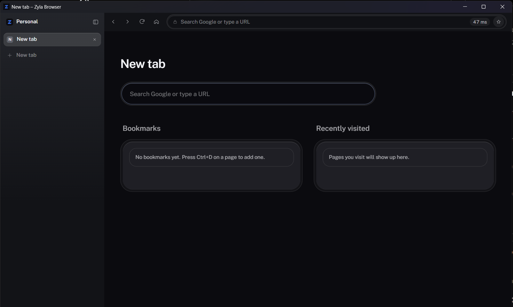
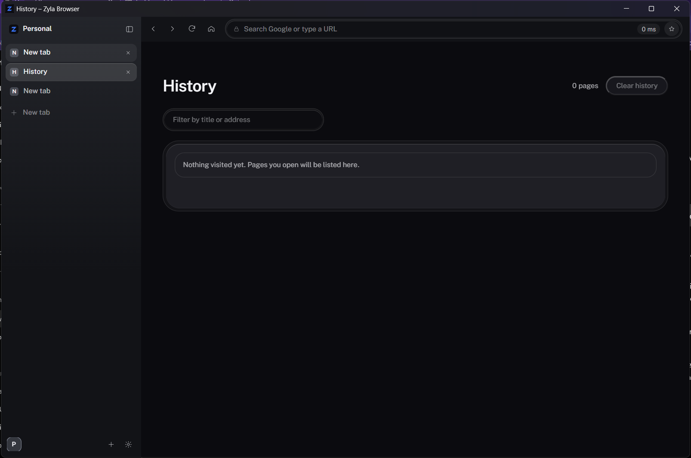

<p align="center">
  
</p>

<h1 align="center">Zyla Browser</h1>

<p align="center">Two pages, one window.</p>

<p align="center">
  A keyboard-first Windows browser with flexible tabs, side-by-side split view, and a local password vault.
</p>

<p align="center">
  <a href="https://github.com/GumballGaming/zyla-browser/releases/latest">Download for Windows</a>
  ·
  <a href="https://github.com/GumballGaming/zyla-browser/issues">Report a problem</a>
</p>



Zyla is a small, open-source browser for Windows. It uses the system WebView2 engine for websites and gives you a focused browser shell: tabs in a sidebar or top strip, split view, bookmarks, history, and keyboard shortcuts.

## What it does

- Put tabs in a sidebar or a familiar top strip.
- Show two tabs side by side with **Ctrl+\\**.
- Keep tabs isolated in separate WebView2 instances.
- Save session state, bookmarks, and history on this PC.
- Store saved passwords and cards in a vault encrypted for your Windows account with DPAPI. Filling is explicit and limited to HTTPS pages; card security codes are not stored.
- Install unpacked local extensions. Extension toolbar and popup UI are not supported.
- Download files without overwriting an existing file.



## Get Zyla

Download the latest **Windows x64** ZIP from [Releases](https://github.com/GumballGaming/zyla-browser/releases/latest), extract it, and run `zyla-browser.exe`.

Zyla requires the **Microsoft Edge WebView2 Runtime**. Windows 11 normally includes it; install the [Evergreen WebView2 Runtime](https://developer.microsoft.com/microsoft-edge/webview2/) if it is missing.

## Keyboard shortcuts

| Shortcut | Action |
| --- | --- |
| `Ctrl+T` / `Ctrl+W` | Open / close a tab |
| `Ctrl+Shift+T` | Reopen the last closed tab |
| `Ctrl+Tab` / `Ctrl+Shift+Tab` | Move to the next / previous tab |
| `Ctrl+L` or `F6` | Focus the address bar |
| `Alt+Left` / `Alt+Right` | Go back / forward |
| `Ctrl+R` or `F5` | Reload |
| `Ctrl+=` / `Ctrl+-` / `Ctrl+0` | Zoom in / out / reset |
| `Ctrl+D` | Bookmark the current page |
| `Ctrl+H` | Open history |
| `Ctrl+\\` | Toggle split view with the next tab in this Space |
| `F12` or `Ctrl+Shift+I` | Open developer tools |

## Build from source

Building on Windows requires Bun, the stable Rust toolchain with the MSVC target, and the Microsoft C++ Build Tools. The included TSGPUI package archive removes the original machine-local dependency path, so a fresh checkout can install the build tooling from the repository.

```powershell
cd browser
bun install --frozen-lockfile
bun run build
```

`bun run build` recompiles the Rust host before packaging so embedded pages stay in sync with their source. The executable is written to `browser/dist/zyla-browser.exe`. To run the address-bar unit tests, use `bun run test` from `browser/`.

See [browser/README.md](browser/README.md) for development notes and implementation details.

## Current limitations

Zyla is an early release. It has no private window, sync, find-in-page, or automatic password-save prompt. Split view does not survive a restart, and background tabs remain loaded in memory.

## Contributing

Issues and pull requests are welcome. Read [CONTRIBUTING.md](CONTRIBUTING.md) before opening a pull request. Please do not post passwords, browser profiles, or other private browsing data in an issue.

## License

Zyla Browser is released under the [MIT License](LICENSE). The bundled TSGPUI build package is also MIT-licensed; see [THIRD_PARTY_NOTICES.md](THIRD_PARTY_NOTICES.md) for its source and notice.
